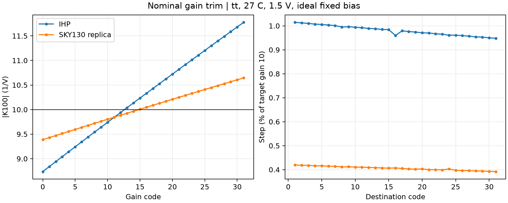
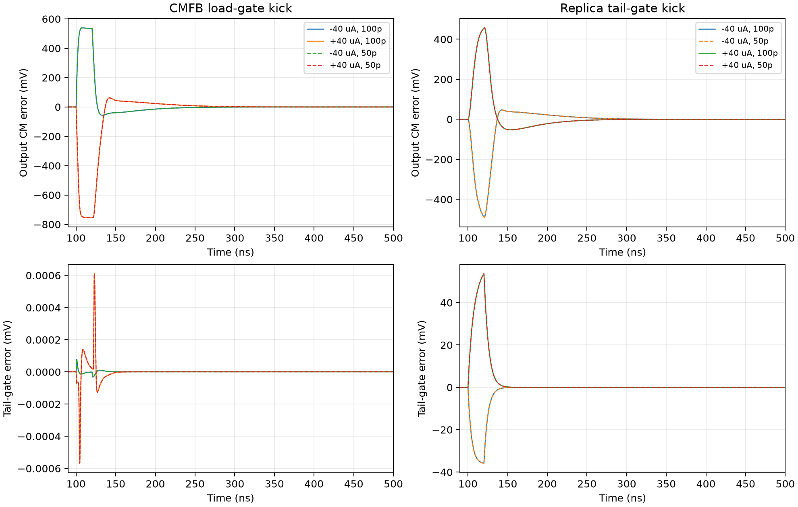
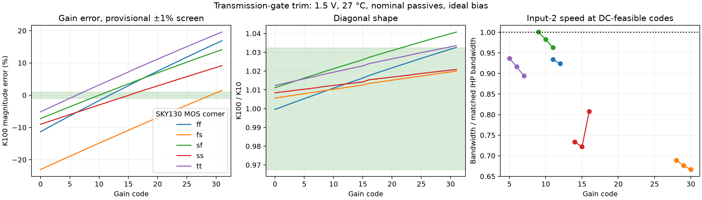
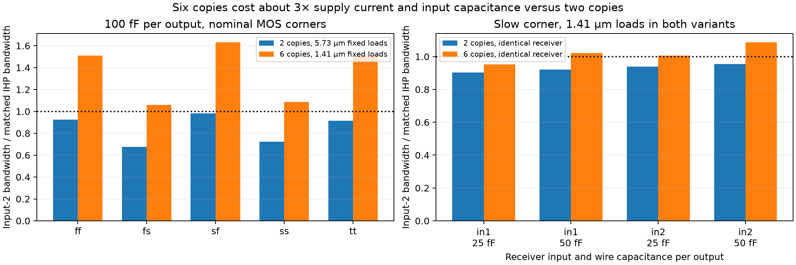

# IHP SG13CMOS5L versus SKY130A

Acceptance clarification, 2026-11-03: every PVT corner needs at least one code satisfying all applicable specifications simultaneously, and the code may change with PVT.
Failures at unused codes are allowed.
Earlier fixed-code comparisons below characterize drift and the tested operating settings, not exhaustive per-corner infeasibility.
A gain-only or shape-only passing code does not establish full specification coverage.
Numerical gain tolerance is pending confirmation.

This report is incremental.
The transistor-replica version of the compact two-copy candidate passes all 45 original-range diagonal-curvature cases with fixed per-corner current codes.
Its nominal full-surface error is below the IHP reference.
All 45 bandwidth captures and both sets of 45 feedback-loop captures pass the independent waveform audit.
The two feedback loops meet their provisional margin limits.
Fifteen full transfer surfaces at 1.5 V show lower peak error than IHP in every matched MOS/temperature case, with three RMS-error regressions.
The drawn replica view is electrically equivalent to its characterized source at nominal conditions.
Full-port equivalence and physical signoff remain open.
The latest measured checkpoint is summarized first, with the earlier candidates retained below to explain the sizing decisions.

## Current transistor-replica checkpoint

The following nominal results use tt, 27 C, 1.5 V, common mode 0.75 V, gain code 13 and 100 fF per output.
IHP uses a 40 uA unit reference.
SKY130 uses two parallel circuit copies, 0.35 um PMOS loads, resistance scale 1.46 and 33.75 uA unit reference.
The full operating range remains 1.45/1.5/1.65 V and 0/27/80 C.

| Metric | Current IHP core | SKY130 transistor-replica candidate |
|---|---:|---:|
| Fitted product gain | -10.00640 V^-1 | -9.97783 V^-1 |
| Peak fitted transfer error | 1.38043% | 1.02346% |
| RMS fitted transfer error | 0.48130% | 0.39973% |
| Bare-core bandwidth, inputs 1/2 | 426.673/836.155 MHz | 592.706/845.691 MHz |
| Input capacitance per pin at 1 MHz, inputs 1/2 | 171.090/131.584 fF | 185.419/83.8715 fF |
| Input noise at 1 MHz, inputs 1/2 | 20.3362/20.3247 nV/sqrt(Hz) | 16.8151/14.2876 nV/sqrt(Hz) |
| Integrated input noise, 1 kHz to 100 MHz | 149.052/146.311 uVrms | 149.314/124.668 uVrms |
| CMFB phase margin | 60.5671 degrees | 101.600 degrees |
| CMFB gain margin | 18.0002 dB | 14.3740 dB |
| Supply current | 0.718416 mA | about 1.199 mA |

Noise uses the other differential input held at 100 mV.
The first-input integrated noise is essentially unchanged, and the CMFB gain margin remains lower.
The replica adds about 12.5 percent to input-1 capacitance relative to the preceding compact candidate.
Its local bias loop has nominal phase margin 85.9634 degrees and gain margin 33.0437 dB.
The loop bench breaks the shared gate connection so both the reference and main tail gate loads remain present.
The small nominal input-2 bandwidth advantage still needs extracted confirmation.
These measurements do not qualify mismatch, startup, actual bias circuitry or physical layout.

## Replica feedback and bandwidth across PVT

All runs retain one fixed current code per raw SKY130 MOS corner, with supplies 1.45/1.5/1.65 V and temperatures 0/27/80 C.
The feedback-loop measurements use ideal input common-mode, output common-mode and bias references.
Their exported complex return ratios independently reproduce the scalar margins and crossing counts.

| Measurement | Minimum over 45 cases | Maximum over 45 cases |
|---|---:|---:|
| Input-1 bandwidth | 478.294 MHz | 655.962 MHz |
| Input-2 bandwidth | 693.129 MHz | 1077.460 MHz |
| Input-1 capacitance per pin | 146.738 fF | 223.750 fF |
| Input-2 capacitance per pin | 74.7499 fF | 94.0107 fF |
| CMFB phase margin | 81.6713 degrees | 111.164 degrees |
| CMFB gain margin | 14.1532 dB | 15.5771 dB |
| Replica-bias phase margin | 85.7102 degrees | 92.5843 degrees |
| Replica-bias gain margin | 32.5053 dB | 38.7649 dB |

Every loop capture has exactly one unity crossing.
The 90 core gain curves were checked against separately captured DC-frequency gain and 3 dB bandwidth.
The 90 loop curves were checked against phase margin, gain margin, unity frequency, phase-crossing frequency, DC gain and crossing count.
Frozen scalar tables, waveform archives and audits carry the sky_replica_ac_pvt, sky_replica_cmfb_pvt and sky_replica_bias_loop_pvt prefixes in evidence/.

The historical IHP bench holds its trim-drive high level at 1.5 V during the supply sweep.
Its bare-core PVT bandwidth spans 379.086 to 456.491 MHz on input 1 and 800.967 to 864.774 MHz on input 2.
With that drive tracking VDD, the matched code-13 ranges become 377.324 to 461.305 MHz and 790.231 to 886.981 MHz.
The SKY130 input-2 minimum remains below that IHP range.
This is not full-range performance equivalence.
The comparison also retains fixed gain code 13, so gain normalization and actual DAC/reference impedance remain separate checks.

## Replica receiver loading and corner surface shape

A driver feeds input 1 or input 2 of an identical receiver core with its own CMFB loop and bias.
The receiver's other differential input is held at 100 mV and its output load is 100 fF per pin.
The table gives driver bandwidth, with 25/50 fF added per driver output as a wire-capacitance proxy.
Both designs use nominal conditions and gain code 13.
The load excludes the offset DAC and tile output buffer.

| Receiver input | Wire load per output | IHP driver BW, inputs 1/2 | Replica driver BW, inputs 1/2 |
|---|---:|---:|---:|
| 1 | 25 fF | 331.819/511.728 MHz | 449.019/566.773 MHz |
| 2 | 25 fF | 373.239/612.754 MHz | 578.295/813.008 MHz |
| 1 | 50 fF | 315.648/463.835 MHz | 425.050/528.008 MHz |
| 2 | 50 fF | 352.942/548.314 MHz | 541.655/735.518 MHz |

All eight nominal bandwidth comparisons improve over IHP despite the replica's extra input-1 capacitance.
These are transistor receiver loads, not extracted tree interconnect.

The matched full-surface grid covers five MOS corners and 0/27/80 C at 1.5 V only.
Each case uses all 1681 input pairs from -100 to +100 mV in 5 mV steps.
A constant, two feedthrough terms and the product term are fitted independently, and shape error is normalized to that case's fitted full scale.
The SKY130 and IHP skew labels are reversed before matching N/P speed cases.

SKY130 peak residual spans 0.827867 to 1.530329 percent, versus IHP's 1.118381 to 1.587047 percent.
Every one of the fifteen matched cases has lower peak residual on SKY130.
RMS residual improves in twelve cases but worsens at all three temperatures of the N-fast/P-slow corner.
The worst RMS comparison is SKY130 sf at 0 C, 0.617139 percent versus IHP fs at 0 C, 0.540532 percent.
Thus lower peak error does not imply uniformly lower distortion over the full input square.
Supply-extreme full surfaces, gain-trim coverage, mismatch and real bias references remain open.

## Drawn view and reference update

The replica candidate now has separate wired Xschem sheets for the core, gain trim and OTA under verification/porting/sky_replica_schematic.
A netlist comparison verifies all 132 instances, ordered device terminals, external ports and numerical parameters.
Its negative controls reject a shorted quad bulk and a one-percent width error.
Chipify replay of the drawn netlists matches 48 nominal scalar measurements and all three requested waveform captures, including every point of the transfer square.
The main chip macro folders remain the initial mapping, and the experimental view is not a released physical design.

The IHP source advanced from 3764a02 to 93ff956 during this work.
Git blob checks confirm that the multiplier, gain-trim and OTA schematics used for the core baseline are unchanged.
The new system adds a readout current DAC in every bias channel, grows the tile register to 32 bits and the full frame to 512 bits, and removes the vb_ostg tree pin.
The port plan follows that updated interface.
Earlier tile, readout and bias-chain measurements remain identified with the original source snapshot, and do not qualify the updated system.

## Gain-trim coverage and trim-drive control

Endpoint screening uses gain codes 0 and 31 over five MOS corners, three supplies and three temperatures, with nominal resistor models and ideal bias references.
SKY130 retains the per-corner current codes selected by the diagonal-curvature screen.
IHP uses a 40 uA reference throughout.
A target bracket means only that the two endpoint magnitudes straddle 10 per volt.
It does not prove monotonicity, a sufficiently fine code step or a code meeting both gain and shape limits.

| Endpoint screen | K100 target bracket | K10 target bracket |
|---|---:|---:|
| SKY130 replica, trim high tracks VDD | 18/45 | 15/45 |
| IHP, historical fixed 1.5 V trim high | 30/45 | 30/45 |
| IHP, trim high tracks VDD | 28/45 | 30/45 |

All fifteen 80 C cases lack K100 endpoint coverage for both PDKs under these fixed ideal-current conditions.
The SKY130 candidate also misses six cases at 0 C and six at 27 C.
Its 90 endpoint measurements are valid, but three endpoints exceed the provisional diagonal-ratio limit.
These results do not establish actual bias-chain or per-die calibration performance.

The IHP gate-drive control matters even with unchanged device geometry.
At codes 0 and 31, replacing the fixed 1.5 V trim-high level with VDD changes K100 by up to 7.22 percent and input-2 bandwidth by up to 9.04 percent.
At comparison code 13, the maxima are 3.59 percent and 3.80 percent.
All nominal 1.5 V comparisons are unaffected.
The historical reference tables remain preserved, and the normalized code-13 control is retained separately in evidence/ihp_midcode_rails.csv.

## Nominal gain-code resolution

A complete 32-code sweep at tt, 27 C and 1.5 V confirms strictly increasing gain magnitude in both designs.
The reference current and other conditions match the endpoint screen.

| Nominal code sweep | IHP | Original SKY130 replica |
|---|---:|---:|
| K100 magnitude range | 8.73787 to 11.7761 V^-1 | 9.38744 to 10.6451 V^-1 |
| K100 step, percent of target gain 10 | 0.9480 to 1.0146% | 0.3920 to 0.4198% |
| Nearest K100 code and residual | 13, +0.387% | 15, +0.066% |
| K10 magnitude range | 8.62523 to 11.4864 V^-1 | 9.27627 to 10.4082 V^-1 |
| Nearest K10 code and residual | 15, +0.427% | 20, +0.177% |

The smaller SKY130 step improves nominal quantization but reduces available correction range.
These monotonicity results apply to one nominal point, not mismatch or all PVT combinations.
All 32 SKY130 codes meet the provisional diagonal-ratio screen.

A separate resistor-range experiment scales the fixed loads and the gain-trim segments independently.
At fixed-load scale 0.8 and trim-segment scale 2, the fs endpoints span K100 magnitudes 9.67735 to 12.0350, but the tt lower endpoint is already 10.4735.
Multiplying the trim resistance alone therefore cannot center every corner.
At trim-segment scale 4 both corners also fail the endpoint shape screen.
The next control reduces the fixed-load scale to 0.6 while retaining trim scale 2.
These controls preserve all MOS dimensions and the replica current calibration.

## Wider trim and laboratory calibration

Separating the fixed and bypassed resistance gives a useful room-temperature range.
With fixed-load factor 0.6 and trim-segment factor 2, all five MOS corners bracket both K100 and K10 magnitudes of 10 at 22 C and 27 C.
All 160 code measurements at 27 C are valid and strictly monotonic.
Some high-gain codes fail the shape limit, but each nearest target code passes it.

The following settings minimize the K100 error at 27 C and 1.5 V with nominal resistors.
Skew corners are matched by transistor speed rather than by their raw PDK names.

| N/P speed | SKY130 raw corner, code | SKY130 residual | IHP raw corner, code | IHP residual |
|---|---|---:|---|---:|
| fast/fast | ff, 8 | +0.2300% | ff, 11 | -0.0060% |
| slow/fast | fs, 13 | +0.2910% | sf, 12 | -0.3521% |
| fast/slow | sf, 10 | -0.5719% | fs, 12 | -0.4330% |
| slow/slow | ss, 6 | -0.2095% | ss, 14 | +0.3020% |
| typical | tt, 2 | -0.6362% | tt, 13 | +0.3870% |

The new SKY130 range reaches every nominal-resistor MOS corner, but its worst quantization residual exceeds IHP.
The per-corner current settings remain ideal sources.
The selected codes are now held fixed for a separate supply/temperature comparison.
These measurements do not establish passive-corner coverage, temperature compensation or real calibration-circuit performance.
The original narrow trim and the wider experimental network remain separate candidates.

## Wider trim limitations at fixed calibrated codes

Holding the selected room-temperature codes fixed gives 40 of 45 SKY130 shape passes, compared with 45 of 45 for IHP.
All scalar results are valid, and all 90 SKY130 gain curves independently reproduce their gain and bandwidth anchors.

| Calibrated fixed-code range | IHP | Wider SKY130 replica |
|---|---:|---:|
| K100/K10 | 1.00820 to 1.02597 | 0.994979 to 1.04583 |
| Input-1 bandwidth | 376.278 to 466.438 MHz | 321.821 to 607.173 MHz |
| Input-2 bandwidth | 783.939 to 911.809 MHz | 392.448 to 862.940 MHz |

SKY130 is faster on input 1 in 27 of 45 matched cases and on input 2 in none.
Its worst input-2 ratio to IHP is 0.4727.
The five shape failures are fs at 0 C/1.65 V, sf at 0 C/1.45 V and 27 C/1.45 V, ss at 0 C/1.45 V, and tt at 0 C/1.45 V.
These selected fixed codes do not establish an equivalent port.
The experiment does not determine whether different codes at each PVT point can satisfy all specifications simultaneously.
The preceding original replica measurements remain valid for that separate geometry.

An independent gate-drive diagnostic holds sf at 1.45 V and gain code 10.
At 0 C, raising only the ideal trim-high rail from 1.45 to 1.65 V changes K100 magnitude from 11.3708 to 9.41784, diagonal ratio from 1.04583 to 1.01648 and input-2 bandwidth from 617.098 to 736.863 MHz.
At 27 C the corresponding ratios are 1.03622 and 1.01267.
The unchanged-rail DC controls reproduce their PVT values to saved precision, and the bandwidth controls agree within 3.3 parts per million.
This isolates a substantial trim-drive dependence, but does not prove improved shape at matched gain.
The over-rail settings are diagnostic stimuli, not proposed chip interfaces.

## Nominal recovery of both replica loops

The original replica at tt, 27 C, 1.5 V and gain code 13 was tested with a 20 ns current pulse of either polarity at the CMFB load-gate node and at the shared replica/main tail-gate node.
Amplitude is 40 uA, compared with the 67.5 uA total ideal reference.
Both loops remain closed.
Eight runs cover the four kicks at maximum steps of 100 ps and 50 ps using trapezoidal integration.

All eight runs finish and pass independent waveform/scalar checks.
Output common-mode excursions reach 457 to 753 mV, so these are large-signal stress kicks.
Recovery to within 1 mV takes at most 197.405 ns after the pulse.
The directly disturbed tail gate returns within 1 mV in at most 21.325 ns.
The largest output waveform difference after halving the time step is 0.176 mV.
The two step choices agree on common-mode settling within 0.03 ns.
The final 900 to 1000 ns window has no sustained oscillation, with output residual below 0.004 uV peak to peak.

These are nominal recovery measurements about an established operating point with ideal references.
They do not establish startup, PVT recovery or the wider trim network's transient behavior.
The evidence is sky_replica_kick.csv, its waveform archive and the independently computed summary.

## Mid-rail switch type and length controls

Independent fixtures hold each switch source/drain pair at 0.75 V common mode and 1 mV differential bias.
Each unit has width 7.365 um.
Five MOS corners and five supplies from 1.45 to 1.65 V are measured at 27 C.
The original type comparison uses 0.35 um channel length, with one NMOS, one or two PMOS units, and their parallel transmission-gate combinations.
Every captured curve passes scalar anchors and parallel-conductance checks.

At tt, the NMOS resistance falls from 3024.59 to 691.94 ohm across the supply range.
The PMOS resistance instead rises from 3174.48 to 3530.10 ohm.
At 1.5 V, the PMOS resistance ranges from 1977.54 to 8005.86 ohm over MOS corners.
Two PMOS units in parallel reduce that resistance, but add device area and capacitance.
The transmission-gate controls still have substantial supply dependence.
These primitive results do not qualify a replacement switch network.

A separate 20-case sweep changes only NMOS length to 0.15/0.35/0.5/1 um.
At fs and 1.5 V, shortening from 0.35 to 0.15 um increases resistance from 2743.24 to 3794.02 ohm.
The ratio of resistance at 1.65 V to that at 1.45 V falls from 0.17465 to 0.06731, so supply sensitivity worsens.
At tt, the shorter device lowers nominal resistance from 1752.14 to 1388.95 ohm but also worsens this ratio from 0.22877 to 0.12933.
Minimum channel length is therefore not a general solution to this mid-rail switching problem.
Longer devices reduce relative sensitivity but increase resistance.
Mismatch, capacitance and equal-gain circuit comparisons remain required.

## PMOS and transmission-gate trim endpoint screens

Two new candidates retain the original segment proportions and scale both fixed and trim resistors by 1.7.
The PMOS-only candidate replaces each inherited NMOS group with four parallel PMOS copies.
The transmission-gate candidate retains the NMOS group and adds two parallel PMOS copies.
Each PMOS well connects to the core supply, and ideal complementary gate levels preserve code polarity.
The physical complement drivers are not qualified.

All twenty endpoint cases are valid at 27 C and 1.5 V with nominal passives and the retained per-corner current settings.
The PMOS-only candidate brackets K100 magnitude 10 in four of five MOS corners.
At sf its minimum is 10.1380, already above target.
The transmission-gate candidate brackets K100 in all five corners.
Its ranges are ff 8.86746 to 11.6885, fs 7.69502 to 10.1455, sf 9.27303 to 11.4124, ss 9.09682 to 10.9150, and tt 9.48262 to 11.9571 per volt.

Both candidates miss the K10 target at fs, where the upper endpoint is 9.94709.
Both also exceed the diagonal-shape limit at the maximum code in ff, sf and tt.
Thus endpoint coverage selects the transmission gate for a matched-gain follow-up, but establishes neither an acceptable intermediate code nor speed, loop, passive-corner or mismatch performance.
The retained evidence uses the sky_trim_pmos4_endpoints and sky_trim_tg2_endpoints prefixes.

## Manufacturing-grid control

Continuous electrical exploration produced dimensions such as 6.21875 um input-pair finger width and 0.920120439 um source-resistor length.
A separate control rounds per-finger width, channel length and resistor length to 0.005 um, consistent with the template's layout database grid.
The pair finger becomes 6.22 um and the replica remains exactly one eighth of the pair width.
The source resistor length becomes 0.92 um.
The generator recalculates source/drain area, perimeter and squares when a MOS finger width changes.

At nominal conditions the quantized candidate gives fitted gain -9.97638 per volt, peak/RMS residual 1.02313/0.39961 percent, and bandwidth 592.871/846.038 MHz.
Input capacitances are 185.442/83.8718 fF.
Input noise at 1 MHz is 16.8139/14.2866 nV/sqrt(Hz), and integrated noise is 149.304/124.660 uVrms.
The small nominal changes support using a grid-aligned candidate for further checks.
They do not transfer the earlier corner, loop or layout verdicts to this geometry automatically.

## Comparison protocol

Use identical input amplitudes, common-mode references, loads and definitions, with the original 1.45 to 1.65 V supply range as the primary comparison.
Record a separate 1.8 V case if evaluated.
Separate deterministic corners, local mismatch and global process statistics.
Read simulator validity and waveform capture in addition to spec pass flags.
The reference design is pinned in evidence/provenance.json.

## Reproduced IHP reference

Measured with Chipify 0.2.3 from local source commit 1960c81 and the image's ngspice 47.
The frozen cell uses 59.7/0.28 um PMOS inputs, 20/0.5 um NMOS quad devices and an eightfold tail mirror.
The supplied bench's 40 uA reference therefore represents approximately 320 uA in the core tail.
Older results for a smaller 40 uA-tail cell must not be treated as this revision's bandwidth or mismatch results.

| Metric | IHP measured, schematic | Initial SKY130 mapping |
|---|---:|---:|
| Supply and temperature | 1.5 V, 27 C | 1.5 V, 27 C |
| Gain at four quadrant 100 mV inputs | -10.0387 V^-1 | -5.90626 V^-1 |
| Gain at four quadrant 10 mV inputs | -9.85739 V^-1 | -5.51704 V^-1 |
| Gain ratio, 100 mV / 10 mV | 1.01839 | 1.07055 |
| First-input-only gain ratio | 0.977262 | 1.03263 |
| Second-input-only gain ratio | 1.04751 | 1.04992 |
| Differential output at +100 mV, +100 mV | -100.387 mV | -59.0626 mV |
| Output common mode | 757.967 mV | 753.017 mV |
| Deterministic balanced output offset | -2.76e-13 V | Pending |

The nominal scalar table has no min/max limits, so its reported 100 percent yield means valid capture only.
It is not an equivalence or signoff verdict.
Full scalar values and the generated reference netlist template are retained under evidence/.

## Remaining qualification

Core sizing and bias must first meet the original-range corner requirements.
Complete the real current DAC and voltage references, output stage, bandgap, mismatch qualification, startup and tree-level stability.
Python-generated layout, physical area, DRC/LVS and extracted performance follow schematic qualification.
The measurements below cover primitive mapping, candidate sizing, nominal noise and loop gain, input loading, transfer surfaces and several rejected PVT families.

## Current IHP schematic across corners

The 135-case reproduction sweeps five MOS corners, three resistor corners, supplies 1.45/1.5/1.65 V and temperatures 0/27/80 C.
All 135 rows, 1350 scalar values and 135 waveform files passed the independent data audit.
With gain code 13 fixed, K100 ranges from -12.4175 to -7.25745 V^-1, gain ratio from 1.00508 to 1.03242, and common mode from 756.207 to 763.491 mV.
These are measured ranges, not an all-corner K=10 guarantee.

The separately reproduced nominal bandgap gives 910.440 mV and 3.81681 uA per line.
The sixteen-channel bias distribution gives 749.512 mV common-mode reference, 800.159 mV output bias, 40.3056 uA cell reference and 40.2441 uA CMFB reference.
The nominal tile draws 1086.76 uA in its stated bench.
The current IHP mult_cell bandwidth bench reports 254.451 to 354.517 MHz across its four path/loading combinations, with code 14 giving K = 10.0243 V^-1.
These bandwidth figures replace the earlier small-cell bandwidth as the current comparison target.

## SKY130 primitive and headroom findings

For an isolated diode-connected 20/0.5 um NMOS with four fingers at 80 uA, VGS is 732.2 mV for the standard device and 620.2 mV for the low-threshold device.
For a 74.625/0.35 um PMOS with twelve fingers at 160 uA, |VGS| is 1.070 V standard and 474.3 mV low threshold.
These primitive probes have no extracted interconnect and are sizing measurements, not complete operating-range guarantees.

The first low-threshold mapping has -71.8 mV of NMOS folding-mirror saturation margin at balance.
Increasing VDD to 1.8 V while keeping the input common mode at 0.75 V does not solve this internal voltage budget.
The relevant voltage is available between ground and the quad source, which the input common mode and quad VGS determine.
A fourfold mirror width and twofold input-pair width restore nominal gain to -9.97492 V^-1 with ratio 0.988612, but leave only 7.0 mV of mirror margin.
That point is rejected as a qualified sizing choice.
A second sweep trades mirror length and width against headroom and linearity.
Even a nominal match is held from layout until PVT, bandwidth, noise and loop checks pass.

## Resistor and connectivity mapping

The IHP nominal trim segment is about 56.64 ohm after its two parallel copies.
A 5.73 um SKY130 precision-poly resistor measures 96.28 ohm at L=0.5 um and 124.51 ohm at L=1 um before parallel copies.
Its nominal low-voltage relation is approximately 68.05 + 56.46 L ohm, with L in um.
The 1.41 um family has a different end-voltage expression, including a shifted voltage argument.
Its short devices cannot be sized by sheet resistance alone.
These observations drove separate mappings for short trim segments and long reference resistors.

A netlist audit checked the terminal connectivity of 103 MOS and resistor instances across the core, trim ladder and CMFB.
Four resistor bulk connections change intentionally from the IHP n-well tie to the SKY130 substrate tie.
The audit does not establish layout connectivity or extracted performance.
Tap ties use a 1 milliohm simulation abstraction with LVS short semantics, since an ideal voltage source can form a forbidden loop when the parent already ties both tap ports together.

## Flow changes and publishing status

The SKY130 template runtime wrapper is committed as 8c39e53 on work-santi.
Its inverter DC result is unchanged at vgsp_at_vcm = 0.9071777 V.
The startup probe verifies that the intended SKY130 optimization setting becomes active even when Chipify launches ngspice from a scratch directory.
GitHub rejected the template push for lack of write access.
The destination design repository still needs a remote.

## Bandwidth and sizing tradeoffs at identical load

A separate bare-core comparison uses the same 100 fF load on each output, 1.5 V supply, 0.75 V input and output references, and one input fixed at 100 mV while the other receives the small-signal AC stimulus.
The IHP reference gives 426.673 MHz on input 1 and 836.155 MHz on input 2, with 718.416 uA supply current.
This is a different load from the current mult_cell bench's next-stage inputs and output buffer.

The first SKY130 speed sweep used folding mirrors of L=0.15 or 0.25 um.
Its 24 points were valid, but K100/K10 ranged from 0.836181 to 0.902001.
Bandwidth alone therefore cannot select the port.
A second 24-point sweep used 0.5 or 1.25 um folding mirrors and smaller quad devices.
One point, mirror W=80 um L=0.5 um, quad W=10 um L=0.15 um, pair W=74.625 um L=0.35 um, reaches K100=-9.45796, ratio 0.978145 and bandwidth 487.322/787.450 MHz.
Its 14.660 mV mirror margin remains too small to accept without corner checks.
Longer 1.25 um mirrors improve some curvature points but lower input-1 bandwidth to 149 to 254 MHz.
Parallel circuit scaling and resistor adjustment remain exploratory, with no accepted final sizing.

## Statistical model controls

Thirty-two primitive cases separate deterministic models, local mismatch and global process variation.
Eight seeds of tt with mc_pr_switch=1 gave exactly the same measured values as deterministic tt.
The mc section gave 6.542 mV sample standard deviation in the diode-connected LVT NMOS VGS, while the difference between equal devices stayed zero.
The tt_mm section gave 2.160 mV standard deviation in the pair difference.
Both precision-poly families have local mismatch in their wrapper models, contrary to the earlier template guide.
At L=10 um the eight-seed relative pair-difference standard deviations are 0.4784% for 5.73 um and 0.8464% for 1.41 um resistors.
These controls establish model activation, not reliable spread or yield estimates.

The template guide and inverter CACE process selection were corrected.
A 200-sample process-only inverter run using mc passed its existing limits, with gain 25.138 to 34.881 dB and bandwidth 689.573 kHz to 1.98538 MHz.
The primitive controls are also provided as a reusable Chipify project in testbenches/chipify/sky_statistics.

## Corner rejection and next device choice

Parallel copies at constant device voltage and inversely scaled resistance improve bandwidth under the fixed 100 fF external load.
At mirror scale 6, pair scale 0.75, 10/0.15 um LVT quad, resistor scale 1.1 and two parallel copies, the measured gain is -9.76893 V^-1, ratio 0.980359, bandwidth 459.448/1070.30 MHz and supply current 1.225 mA.
This is an exploratory nominal result.

The following 45-case check used resistor scale 1.14 and swept five MOS corners, three supplies and three temperatures.
All 720 scalar captures were valid.
Only 20 cases met the provisional checks: positive tail and mirror saturation margins and a gain ratio between 0.96758 and 1.03242.
This provisional ratio window uses the maximum magnitude of the reproduced IHP corner deviation from unity, and does not replace matched-corner or full transfer-surface comparisons.
The candidate is rejected.
At the fs corner, mirror margin reaches -35.66 mV and gain ratio reaches 1.19769.
At sf, tail margin reaches -52.98 mV.
The fixed-current all-LVT mapping therefore cannot be accepted from its nominal gain and bandwidth.

Tying the quad body to its source buys only about 10 to 20 mV in the tested points, before any well parasitics.
The native 3.3 V NMOS quad gives 353 to 523 mV nominal mirror margin in the first four valid geometry probes, but needs more width to recover gain.
These are schematic alternatives, not selected physical implementations.
The first native sweep failed because 5 um fingers fell outside all nine model bins.
The corrected probes use supported 4 um fingers at L=0.5 um, as described in [the geometry guide](../sky130A-Open-PDK/device-model-geometry.md).

## Skew-corner interpretation and native-quad rejection

The SKY130 device probes show sf means fast NMOS and slow PMOS in the installed models, while fs means slow NMOS and fast PMOS.
This reverses the IHP library's documented transistor order.
Semantic cross-process comparisons therefore map IHP mos_sf to SKY130 fs and IHP mos_fs to SKY130 sf.
Raw evidence keeps each PDK's own labels.

The 45-case IHP bare-core bandwidth sweep gives 379.086 to 456.491 MHz on input 1 and 800.967 to 864.774 MHz on input 2.
Its tail margin reaches -17.9 mV at a few low-supply points while the measured gain remains well behaved.
A zero-margin screen is therefore conservative and cannot serve as the sole equivalence criterion.
The saturation indicators also come from different compact models.

The native-quad candidate has positive folding-mirror margin, but its quad margin reaches -84.4 mV at the SKY130 sf corner.
A native transistor's gate and drain at the same common-mode voltage do not guarantee saturation.
Across the 45 cases its gain magnitude spans 2.3803 to 14.6000 V^-1.
The native substitution is rejected for equivalent transfer behavior, despite the large mirror margin.
The next candidate uses modeled source-degeneration resistors with wider LVT quad and tail devices.

## Source degeneration, noise and common-mode feedback

The four-copy source-degeneration candidate uses 60 ohm effective source resistors in each LVT quad arm, implemented by four parallel res_high_po_5p73 devices rather than ideal resistors.
Its unit dimensions are 120/0.5 um folding mirrors, 149.25/0.35 um input devices and 40/0.15 um quad devices.
Doubling the tail mirror width improves tail headroom.
At tt, 27 C, 1.5 V, code 13 and 100 fF per output, K100 is -9.99565 V^-1, K100/K10 is 1.01218, bandwidth is 474.822/1119.29 MHz and supply current is 2.611 mA.
The IHP bare core draws 0.718416 mA under the same bias and load definition.
The SKY130 candidate therefore costs about 3.63 times the bare-core current.

All 45 MOS/supply/temperature cases produce valid measurements.
Only 23 meet the provisional 0.96758 to 1.03242 gain-ratio window.
The ff and fs corners show expansion, with fs reaching 1.1123, while ss can compress to 0.9511.
The fs folding-mirror margin reaches -5.9 mV.
This candidate is not accepted as an equivalent port.

Matching nominal noise benches hold one input at 100 mV differential and measure noise referred to the other input.
Both integrate from 1 kHz to 100 MHz and use the same 100 fF output loads.

| Nominal schematic metric | Current IHP | SKY130 degeneration candidate |
|---|---:|---:|
| Input-1 noise at 1 MHz | 20.3362 nV/sqrt(Hz) | 7.79333 nV/sqrt(Hz) |
| Input-2 noise at 1 MHz | 20.3247 nV/sqrt(Hz) | 6.58537 nV/sqrt(Hz) |
| Input-1 integrated noise | 149.052 uVrms | 74.9687 uVrms |
| Input-2 integrated noise | 146.311 uVrms | 63.4849 uVrms |
| CMFB phase margin | 60.5671 degrees | 47.6232 degrees |
| CMFB gain margin | 18.0002 dB | 9.59422 dB |
| CMFB unity frequency | 14.4654 MHz | 18.3655 MHz |

These are schematic nominal measurements, not mismatch, PEX or loaded-tree results.
The noise source must have an AC magnitude of one or ngspice cannot compute the input-referred quantity.
The initial missing-AC bench was corrected before retaining these values.
The SKY130 common-mode loop fails the 10 dB minimum gain margin.
Increasing only the fast-loop degeneration resistance worsened phase margin, reaching 26.65 degrees at three times the mapped resistance and 100 fF load.
The next compensation experiment separates the slow integrating loop with a larger gate capacitor before tuning the fast-loop resistance.

Evidence: `evidence/ihp_core_noise.csv`, `evidence/ihp_core_stability.csv`, `evidence/sky_degenerated_noise.csv`, `evidence/sky_degenerated_stability.csv` and `evidence/sky_degenerated_corners.csv`.
The independent corner audit distinguishes valid data from failed specifications.

## Full transfer surface and separate input curvature

The nominal transfer surfaces contain all 1681 combinations of input differentials from -100 to +100 mV in 5 mV steps.
A least-squares fit uses constant, input-1 feedthrough, input-2 feedthrough and product terms.
Residuals are normalized by the fitted product gain times 0.01 V^2, so gain error and shape error remain distinct.

| Nominal fitted metric | IHP current core | SKY130 degeneration candidate |
|---|---:|---:|
| Product gain | -10.0064 V^-1 | -10.0853 V^-1 |
| Peak residual | 1.38132 mV | 2.36880 mV |
| Peak residual / fitted full scale | 1.38043% | 2.34877% |
| RMS residual / fitted full scale | 0.48130% | 0.82899% |

The SKY130 candidate's combined gain ratio of 1.01218 hides opposing errors on its two axes.
Holding input 2 at 10 mV, increasing input 1 from 10 to 100 mV changes normalized gain from -9.87541 to -9.47623 V^-1.
Holding input 1 at 10 mV, increasing input 2 to 100 mV instead gives -10.74152 V^-1.
A further 120-case sizing sweep therefore measures each axis separately.
No configuration in that sweep keeps combined gain curvature within the provisional corner window, even at fixed 27 C and 1.5 V.
Its best worst-corner deviation is 4.936%.
The next experiment widens the quad further while reducing input-pair transconductance.

## Loop compensation and DC convergence controls

Increasing the slow-loop MOS capacitor to sixteen times its mapped multiplicity, with fast-loop resistance scaled by 1.5, gives 71.5876 degrees phase margin and 10.5120 dB gain margin at 100 fF.
The nominal 30 fF result is 70.7993 degrees and 10.3237 dB.
This is a compensation experiment, with additional area and settling cost still to evaluate.
A current-kick bench uses trapezoidal integration and checks both 100 ps and 50 ps maximum steps.

The original dense SKY130 DC surface timed out after 600 seconds.
An eleven-point control compared unchanged circuit outputs with alternate solver settings.
Adding 1e12 ohm shunts alone changed output voltages by at most 45 nV but did not remove repeated gmin recovery.
Adding initial guesses on the two outputs, load-gate bias and integrator node removed recovery in that control, with at most 49 nV difference from the original result.
The full 1681-point surface then completed in 58.27 seconds.
These numerical aids are explicit in the generated transfer bench.
They are initial guesses and weak conductances, not forced node voltages.

KLU aborted the same control with no DC data despite returning exit code zero.
It is not selected for these benches.
The audit checks waveform completeness and finite values independently of the simulator exit code.
Evidence and the reproducible control are `evidence/sky_dc_solver_probe.json` and `scripts/probe_sky_dc_solver.py`.

## Matched-skew corner comparison

Each bar spans the nine combinations of supply and temperature for one transistor skew.
IHP and SKY130 skew corners are paired by NMOS/PMOS behavior, not by the literal sf/fs strings.
The SKY130 candidate improves nominal noise and some bandwidth values, but uses more current and has larger transfer error.
It remains a rejected schematic candidate.

## Compensation cost and large-signal recovery

An 80 uA, 20 ns current pulse into the load-gate bias drives the candidate close to the supply rail in common mode.
At fast-loop resistance scale 1.5, the original integrating capacitor settles within 1 mV about 199.9 ns after the pulse ends.
The sixteenfold capacitor does not settle within 1 mV before the 1 us simulation ends.
Its maximum error between 900 ns and 1 us is 1.65098 mV.
Repeating with 50 ps instead of 100 ps maximum steps gives 1.65090 mV.
This is a settling penalty rather than evidence that the larger capacitor is a complete fix.

Scaling the entire fast OTA by four, with reciprocal resistor scaling and the slow loop unchanged, improves nominal margins to 83.1195 degrees and 14.7666 dB with capacitor scale four.
Supply current rises from 2.611 to 3.319 mA.
Shortening both PMOS load and mirror-master devices to 0.35 um while preserving their W/L gives 118.826 degrees and 14.9866 dB at resistance scale one, with current 2.608 mA.
That geometry change requires new transfer, mismatch and corner checks.
It is not included in the previously reported transfer or noise candidate.

The transient audit was corrected to use Chipify's transient metadata key and legacy tran_dir fallback.
All eight traces are finite and reach 1 us.
Missing-waveform and nonfinite-sample controls are rejected.
The complete traces are retained in evidence/sky_cmfb_kick_waveforms.npz.

## Bias calibration experiment at the original supply

A wider quad improves voltage margin but does not remove process-dependent curvature at a single fixed bias.
A fifteen-case current sweep shows that bias can tune curvature substantially.
The following nominal experiment keeps 1.5 V and 0.75 V common mode, uses a 4x quad-width scale, 0.5x input-pair scale, 0.3 um folding mirrors, four circuit copies and 180 ohm unit degeneration resistors.
The effective source resistance is one quarter of the unit value.
Load resistance scale is 1.3.

The ideal reference currents are quantized to (21 + code) times 1.25 uA per circuit copy.
The codes for ff, fs, sf, ss and tt are respectively 3, 11, 12, 30 and 12.
This retains a five-bit code but changes the current-DAC unit from the IHP schematic's approximately 0.95 uA, before the fourfold circuit scaling.
No SKY130 DAC implementation is claimed by this ideal-source experiment.

| SKY130 corner at 27 C | Unit reference current | K100 | K100/K10 |
|---|---:|---:|---:|
| ff | 30.00 uA | -8.98496 V^-1 | 1.02141 |
| fs | 40.00 uA | -9.48636 V^-1 | 1.01437 |
| sf | 41.25 uA | -8.81761 V^-1 | 1.02346 |
| ss | 63.75 uA | -9.93479 V^-1 | 1.02076 |
| tt | 41.25 uA | -9.74103 V^-1 | 1.01800 |

All five pass the provisional diagonal ratio window.
Input-axis curvature, full surfaces, current-source temperature dependence, trim coverage, real bias circuitry and loaded bandwidth still determine acceptance.
The completed original-range sweep and its failures are reported below.

## Separate 1.8 V and 0.9 V common-mode alternative

Raising both supply and signal common mode enables a less aggressive undegenerated LVT core.
One two-copy nominal point uses 40/0.5 um folding mirrors, 20/0.5 um quad devices and the initial mapped input pair.
At load-resistance scale one it gives K100=-9.74012, ratio 0.983951, bandwidth 720.638/1008.690 MHz and supply current 1.379 mA.

With resistor scale 1.03, nominal gain becomes -9.99626 V^-1.
Eleven of fifteen MOS/temperature cases at 1.8 V meet the provisional ratio window.
The worst ratio is 0.932630 at sf and 0 C, so the higher common mode alone does not complete the port.
This experiment changes supply and common mode and is not mixed into equal-supply conclusions.

Differential AC admittance at 1 MHz gives nominal effective capacitance per input pin of 170.400/231.979 fF for this alternative.
The matching IHP measurement gives 171.090/131.584 fF.
The second input therefore loads a preceding stage more heavily even though the fixed-100-fF bare-core bandwidth is higher.
The next-stage transistor load must be included before accepting tree bandwidth.

## Calibrated-candidate follow-up on 2026-10-31

The nominal calibrated 1.5 V candidate gives a fitted product gain of -9.78082 V^-1.
Its full 1681-point transfer surface has 1.02711 percent peak residual and 0.39345 percent RMS residual, both below the IHP nominal values of 1.38043 and 0.48130 percent.
This is an improvement in nominal shape error, with gain still requiring trim.

The fixed per-corner bias settings pass 33 of 45 combinations of 1.45/1.5/1.65 V and 0/27/80 C.
The ss ratio spans 0.955037 to 1.06920 and sf spans 0.947973 to 1.06481.
At 1.45 V and 0 C, tail saturation indicators are -62.65 mV at ss and -41.48 mV at sf.
At 1.65 V they become positive and the same fixed currents produce expansion.
These results identify tail compliance as a remaining supply-sensitivity mechanism.
Nominal bias calibration is insufficient.

The follow-up experiment enlarges the PMOS input pair and adds modeled source resistors.
It recovers tail voltage but imposes the loading and bandwidth costs reported below.
It has not been promoted into the drawn prototype.

The separate higher-common-mode mirror sweep produces 30 valid cases, with 23 inside the provisional ratio window.
At mirror length 0.3 um the ratio spans 0.979283 to 1.04059.
It also remains unqualified.

## Pair-source degeneration trades compliance for input loading

The four-copy follow-up uses pair scale two, quad scale four, folding mirrors at scale eight and length 0.3 um, tail width scale four, load resistance scale 1.38 and unit pair/quad source resistances 240/180 ohm.
Actual source resistances are 60/45 ohm after parallel scaling.
Five-bit bias codes ff=0, fs=8, sf=5, ss=17 and tt=8 use the same ideal (21 + code) times 1.25 uA unit-current experiment.
The fixed currents pass 42 of 45 MOS/supply/temperature cases.

| SKY130 corner | Minimum K100/K10 | Maximum K100/K10 | Minimum tail indicator |
|---|---:|---:|---:|
| ff | 0.999810 | 1.03158 | 242.244 mV |
| fs | 1.00366 | 1.02525 | 237.206 mV |
| sf | 0.974835 | 1.04296 | 45.462 mV |
| ss | 0.980761 | 1.03454 | 36.359 mV |
| tt | 0.994579 | 1.03031 | 134.451 mV |

Every tail indicator is positive, yet three cases still fail the provisional curvature screen.
This separates the remaining temperature dependence from the earlier loss of tail compliance.
It does not establish full-surface accuracy across corners or a physical bias implementation.

The nominal input capacitances are 502.672/619.235 fF per pin at 1 MHz under symmetric differential drive, compared with IHP 171.090/131.584 fF.
The fixed-100-fF bandwidths are 366.019/624.410 MHz, compared with IHP 426.673/836.155 MHz.
Supply current is 2.31553 mA against IHP 0.718416 mA.
The large geometry therefore fails the speed comparison even before its heavier load is applied to a preceding stage.
Scaling circuit current and all device sizes together cannot remove intrinsic cascade loading.
The retained data are evidence/sky_pair_degenerated_pvt.csv, evidence/sky_pair_degenerated_ac.csv and the independent PVT audit.

## AC capture after repeated operating points

The initial compact sizing run produced finite scalar metrics but no requested AC traces in all eighteen cases.
Ngspice 47 names the first AC plot ac17 after seventeen retained operating-point plots.
Chipify 1960c81 injects setplot ac1 and cannot capture that run as declared.
The independent auditor rejected the output despite scalar pass flags.
The rejection record is evidence/sky_compact_capture_rejection.json.

The compact bench now saves scalar values as control variables and clears the old plots before AC.
This restores ac1/ac2 without changing the circuit.
scripts/probe_ngspice_plot_names.py reproduces the plot-name behavior in a PDK-independent RC circuit using the same runtime wrapper.

## Compact candidate speed recovery

After the capture correction, eighteen sizing cases and their AC traces pass the data-integrity audit.
Nine meet the diagonal curvature screen.
A follow-up shortens the core PMOS loads and the fast-OTA mirror devices at constant W/L.
All six nominal combinations of mirror length 0.25/0.3 um and PMOS load length 0.35/0.5/1 um produce valid data and meet that screen.

At mirror length 0.3 um and PMOS load length 0.35 um, the two-copy circuit gives K100=-9.51697 V^-1, ratio 1.01034, bandwidths 609.274/884.406 MHz, input capacitances 161.882/83.8877 fF and current 1.21753 mA.
These measurements use pair scale one, quad scale one, mirror scale four, tail width scale four, pair and quad unit resistors 120 ohm, load-resistance scale 1.38 and 40 uA unit bias.
This recovers nominal speed with input capacitance below the matched IHP values.
Gain, full transfer shape, corner coverage, feedback margins, noise and actual cascaded loading still require qualification.
The retained sweeps are evidence/sky_compact_pair_sizing.csv and evidence/sky_compact_load_sizing.csv.

## Compact candidate across supply and temperature

Five ideal fixed current codes ff=3, fs=2, sf=10, ss=14 and tt=11 use (21 + code) times 1.25 uA per copy.
All 45 cases and their 90 AC curves pass data-integrity and gain/bandwidth identity checks.
Thirty-six cases meet the provisional diagonal-ratio screen.
The sf range is 0.955138 to 1.04897, and ss is 0.959437 to 1.04788.
At the worst low-supply cold point, sf retains only 6.578 mV tail margin.
At fs the folding-mirror indicator reaches -0.111 mV and input-2 bandwidth falls to 690.072 MHz.
Positive tail indicators in the remaining failures show that nominal saturation alone does not establish supply-independent bias.
The results reject this candidate as a completed port.

The exported curves are independently checked against each run's scalar low-frequency gain and 3 dB crossing by scripts/check_core_ac_capture.py.
This catches wrong-plot capture even when every sample is finite.
The retained PVT audit covers all cases, and evidence/sky_compact_pvt_ac_anchors.json records the waveform identity checks.

## Nominal bandwidth with an actual next-core input

Each driver now feeds input 1 or input 2 of a second identical core, with that receiver's other differential input held at 100 mV.
The receiver includes its own CMFB and 100 fF per output.
The driver also sees the stated wire capacitance on each output.
These are core-to-core benches, with tile output stages and offset DACs still to be added.

| Receiver input | Wire capacitance per output | IHP driver bandwidth, inputs 1/2 | SKY130 driver bandwidth, inputs 1/2 |
|---|---:|---:|---:|
| 1 | 25 fF | 331.819/511.728 MHz | 471.907/607.915 MHz |
| 2 | 25 fF | 373.239/612.754 MHz | 575.346/811.244 MHz |
| 1 | 50 fF | 315.648/463.835 MHz | 445.801/563.500 MHz |
| 2 | 50 fF | 352.942/548.314 MHz | 539.004/733.938 MHz |

The compact candidate improves all eight nominal path/load combinations.
This validates the nominal loading benefit beyond a fixed-capacitor bench, while its PVT failures remain unresolved.
The source builder is scripts/prepare_core_fanout.py.
The matched evidence tables are evidence/ihp_core_fanout.csv and evidence/sky_compact_fanout.csv.

## Wrong finite AC curve control

A separate resistor-divider test confirms that a failed managed plot selection can export a complete but incorrect curve.
After two operating points and two AC analyses, Chipify 1960c81 exports the second gain of 0.75 instead of the intended first gain of 0.5.
Scalar metrics, finite samples and global pass flags all look valid.
The reusable control is scripts/probe_chipify_ac_selection.py.
The core AC auditor now compares every captured curve with its corresponding scalar gain and bandwidth.

## Tail-compliance and mirror follow-up

At sf and 0 C, the unmodified compact tail current rises from 334 uA at 1.45 V to 462 uA at 1.65 V, although its external reference remains fixed.
The corresponding diagonal ratio changes from 0.955138 to 1.02049.
A source-tied input pair improves cold low-supply margin by about 10.6 mV, but its high-supply hot ratio grows to 1.05460.
Doubling tail length from 0.65 to 1.3 um while preserving W/L raises current and does not remove the voltage dependence.
That change multiplies tail gate area by four, from 1664 to 6656 um2 for M13 alone in this two-copy candidate.
These are geometric gate areas, not routed macro areas.
Only eleven of the 32 combined well-tie and length cases pass the provisional ratio window.

The twelve-case wider folding-mirror follow-up recovers a small nominal fs margin but reduces input-1 bandwidth.
Its best fs margin in this set is 7.638 mV, still insufficient to establish a robust voltage budget.
The next diagnostic matches the tail-reference drain voltage to the core tail drain, first with an ideal error amplifier.
That ideal amplifier is a causal control, not a qualified implementation.
A separate scaled input-pair replica tests a transistor implementation of the same voltage matching.

The low-threshold PMOS input pair is already at its installed 0.35 um minimum length.
The TT model-bin scan and KLayout PCell coercion both confirm that limit.
A shorter low-threshold pair cannot be used to recover headroom with this PDK.

## Tail-reference voltage matching controls

The active-matching diagnostic moves the tail-reference transistor's gate off its drain and uses an ideal gain-10000 error amplifier to equalize reference and output drain voltages.
Fourteen nominal bias/corner points regulate tail current near the intended eightfold reference ratio.
One tt, 55 uA point converges to a nonphysical -213.825 V gate solution.
The gate-voltage limit rejects that case, so the result is not treated as physical feasibility evidence.
Ideal dependent-source experiments require explicit voltage-domain checks.

The transistor replica uses a one-eighth copy of each input-pair branch and eight series source-resistor units in the reference path.
Its two branch gates follow the corresponding real inputs.
With two circuit copies, each replica PMOS has three full-size fingers, preserving integer physical geometry.
The original reference current flows through this replica and sets the shared tail gate without an ideal error amplifier.

At nominal conditions its tail current is 3.30 to 9.39 percent above the ideal eightfold value over the tested currents and MOS corners.
The replica's source differs from the real pair source by 6.53 to 129.10 mV, so it is not an exact drain-voltage copy.
The pair-drain operating voltages differ between the replica and signal path.
Per-corner current trim must therefore be repeated.
The current sweep places useful shape settings near 26.25 to 33.75 uA, and the fixed-code supply/temperature sweep is the next acceptance check.
Both the active and transistor-replica results are retained as experiments.

## First complete fixed-code curvature screen

The transistor-replica codes ff=1, fs=1, sf=0, ss=4 and tt=6 correspond to unit currents 27.5/27.5/26.25/31.25/33.75 uA.
Each code stays fixed over the three supplies and three temperatures.
All 45 cases meet the provisional ratio limits, with an overall range 0.995562 to 1.02830.
The reference current sources are still ideal, so real DAC and bandgap qualification remains required.

| SKY130 corner | Minimum ratio | Maximum ratio | Minimum tail voltage |
|---|---:|---:|---:|
| ff | 1.00452 | 1.02341 | 270.134 mV |
| fs | 1.00641 | 1.02737 | 306.080 mV |
| sf | 1.00117 | 1.02767 | 56.900 mV |
| ss | 0.995562 | 1.02830 | 81.173 mV |
| tt | 1.01324 | 1.02347 | 163.579 mV |

This is a pass of the diagonal shape screen, not a claim that every electrical requirement is met.
Tail-current ratio still reaches 1.26308 at fs, showing that exact mirror tracking is not what passed.
The observed transfer and the separate noise, bandwidth, feedback and transient tests determine acceptance.
The calibrated nominal surface, AC, noise and both loop data are retained under evidence/sky_replica_*.

## Joint code feasibility under the clarified criterion

Re-auditing all 160 wider-trim measurements at 27 C and 1.5 V gives joint DC-feasible codes ff={8}, fs={12,13}, sf={10,11}, ss={6,7} and tt={2,3} at a provisional one-percent K100 tolerance.
Every listed code also satisfies the diagonal-shape screen and keeps the shared tail gate within the supply rails.
This establishes five of five nominal MOS points for that provisional DC screen.
It does not establish full PVT coverage or bandwidth, noise and stability at the same codes.
The explicit tolerance is not an approved gain specification.
Evidence: evidence/sky_wide_codes_nominal_summary.json.
The complete nominal transmission-gate 32-code sweep and same-code AC follow-up are reported below.

## Transmission-gate joint nominal coverage, 2026-11-09

All 160 nominal code cases are valid at 1.5 V, 27 C and nominal passives.
The retained ideal current setting still differs by MOS corner.
The nearest K100 codes are ff=12, fs=29, sf=10, ss=15 and tt=6.
Their gain errors are +0.1780, -0.0522, -0.0069, -0.0897 and -0.1359 percent respectively.
Every MOS corner contains codes passing the provisional one-percent gain window, diagonal-shape window and tail-gate rail bounds.

All fourteen DC-feasible codes were then measured with the two-input AC bench using the identical core, trim and OTA subcircuits.
All twenty-eight captured gain curves independently reproduce the scalar gain and bandwidth.
The comparison uses the IHP nearest nominal gain code in each corresponding MOS corner with VDD-tracking gate controls.

| SKY130 corner | Joint DC-feasible codes | Best input-2 bandwidth / IHP among those codes | Codes also matching both IHP bandwidths |
|---|---|---:|---|
| ff | 11, 12 | 0.93409 | None |
| fs | 28, 29, 30 | 0.68908 | None |
| sf | 9, 10, 11 | 1.00055 | 9 |
| ss | 14, 15, 16 | 0.80778 | None |
| tt | 5, 6, 7 | 0.93661 | None |

The sf code-9 input-2 advantage is only 0.055 percent, so it provides essentially no design margin.
Input-1 bandwidth is 416.045 to 555.888 MHz across these fourteen codes, and input-2 bandwidth is 559.151 to 856.541 MHz.
At the retained bias settings, four nominal MOS corners have no gain code satisfying this combined gain, shape and matched-bandwidth screen.
This is a same-code intersection over the complete nominal gain-code space at the provisional gain tolerance.
It is not an exhaustive search over bias codes or other geometries.
The full 1440-case gain-code PVT sweep has been launched, but passive-corner, physical bias, noise and loop qualification remain open.
Evidence: evidence/sky_tg2_codes_nominal_summary.json and evidence/sky_tg2_feasible_ac_summary.json.

## Input-2 speed experiments, 2026-11-09

The nominal SKY130 fs corner is the first optimization point because its best DC-feasible input-2 bandwidth is only 68.9 percent of matched IHP.
The initial sensitivity grid retains gain code 29, 1.5 V, 27 C and 100 fF per output.
It varies quad width by 0.5, 1 and 2 and unit reference current over 27.5, 35 and 45 uA.
All nine cases are valid and all eighteen AC curves reproduce their scalar anchors.
The unchanged control reproduces the earlier gain, shape, current, bandwidth and input-capacitance values.

Halving quad width reduces input-2 capacitance from 93.74 to about 48.14 fF at the original current, but gain falls from 9.995 to 7.133 per volt and the diagonal ratio rises to 1.13647.
Increasing current with the original quad raises bandwidth only from 567.085 to 603.207 MHz at 45 uA while the ratio rises to 1.16330.
Doubling quad width at 35 uA gives ratio 1.01805, but bandwidth falls to 514.485 MHz and gain is 11.7551.
These fixed-code points identify tradeoffs, not an exhaustive calibration result.

A separate experiment changes only the two fixed core loads and their two dummy resistors.
The narrower precision-poly families are matched to 1366.81037 ohm per unit at zero differential voltage and 27 C using each model's end expression.
A 1 mV primitive check reproduces this target within four parts per million.

| Precision-poly width | Matched length | Driven-end capacitance per unit | Circuit input-2 bandwidth |
|---|---:|---:|---:|
| 5.73 um | 23.0032 um | 10.5419 fF | 567.085 MHz |
| 2.85 um | 10.8714 um | 3.40775 fF | 613.989 MHz |
| 1.41 um | 4.79211 um | 1.27310 fF | 629.565 MHz |

The 1.41 um load improves input-2 bandwidth by about eleven percent without a material gain, shape or current change at this point.
K100 is -9.99447 and the diagonal ratio is 1.01907.
All six load-study AC curves and the unchanged 5.73 um replay pass the independent checks.
The trim and source resistors remain 5.73 um.
The zero-voltage model lower bounds over positive length are about 227.14 ohm for 2.85 um and 460.70 ohm for 1.41 um, before imposing layout constraints.
These end-resistance terms prevent treating the narrower types as universal replacements for short, low-value trim segments.
Mismatch, resistor corners, physical geometry and full transfer surfaces still need qualification.

A follow-up measures two, four and six parallel copies with the narrow fixed loads.
Any fixed-load speed gain must be reported alongside increased supply current and input capacitance.
An identical downstream receiver also grows with parallel scaling, so a 100 fF benchmark alone cannot establish tree-level improvement.
Evidence: evidence/sky_input2_speed.csv, evidence/sky_input2_load_resistors.csv and evidence/sky_input2_resistor_probe.json.

### Parallel-copy control and geometry restriction

At the narrow-load fs point, two, four and six copies give input-2 bandwidths 629.565, 806.398 and 890.093 MHz into 100 fF.
Their K100=-9.99447 and diagonal ratio 1.01907 are unchanged to the reported precision.
Supply current scales from 0.9873 to 1.9746 and 2.9619 mA, and input-2 capacitance scales from 93.7376 to 187.475 and 281.213 fF.
The six-copy point exceeds matched IHP input-2 bandwidth at this operating point.
This gain costs three times the original two-copy current and gate loading.

An intermediate five-copy diagnostic passed the nominal scalar gain, shape and fixed-load bandwidth screens, but exposed an inherited replica-sizing restriction.
At pair_scale=1, the exact one-eighth replica needs 12*power_m/8 fingers.
Five copies require 7.5 fingers, while the template truncates nf to seven and keeps diffusion expressions based on the original finger width.
The resulting model geometry is not the intended exact-copy layout geometry.
Those five-copy results remain diagnostic, not an accepted sizing choice.
The six-copy candidate uses nine replica fingers and retains the intended unit finger dimensions.
The candidate generator now rejects a nonintegral replica finger count.
A different five-copy replica geometry could be designed explicitly, but is not qualified here.
Evidence: evidence/sky_input2_parallel.csv and evidence/sky_input2_candidate_nominal5_audit.json.

### Six-copy nominal and receiver-loaded results

The six-copy narrow-load candidate has one measured code per nominal MOS corner passing the provisional one-percent gain window, diagonal shape and both matched IHP fixed-load bandwidths.
The gain codes remain ff=12, fs=29, sf=10, ss=15 and tt=6.
All ten bare-core AC curves are independently anchored.

| Raw SKY130 corner | Input-2 bandwidth | Input-2 bandwidth / IHP | Supply current |
|---|---:|---:|---:|
| ff | 1316.960 MHz | 1.50853 | 3.064 mA |
| fs | 890.093 MHz | 1.06100 | 2.962 mA |
| sf | 1396.520 MHz | 1.63131 | 2.917 mA |
| ss | 877.821 MHz | 1.08731 | 3.256 mA |
| tt | 1265.360 MHz | 1.51331 | 3.596 mA |

The full receiver-loaded comparison uses raw SKY130 fs against raw IHP sf, with each design's nominal gain code and an identical downstream receiver.
All twenty-four SKY130/IHP AC curves reproduce their scalar anchors.
For six copies, the input-2 bandwidth ratios to IHP are 0.95277 and 1.02150 when driving receiver input 1 with 25 and 50 fF wire capacitance, and 1.00648 and 1.08698 when driving receiver input 2.
Thus the six-copy signal-tracking replica still misses one loaded case despite passing the fixed-load comparison.
Evidence: evidence/sky_input2_candidate_nominal6.csv and evidence/input2_fanout6_summary.json.

### Common-mode-biased replica control

A further experiment connects both replica gates to a new explicit replica_cm port, driven by the existing ideal common-mode reference in the bench.
This removes their signal-input loading without changing transistor dimensions, reference currents, resistors or gain codes.
The signal-tracking control reproduces both earlier bare-core and receiver-loaded measurements.
All eight curves from the two-mode comparison reproduce their scalar anchors.

At fs, 1.5 V, 27 C, gain code 29 and six copies, input-1 capacitance falls from 483.150 to 392.054 fF.
Receiver-loaded input-2 bandwidth rises from 481.508 to 535.746 MHz for receiver input 1 and 25 fF wire per output.
The latter is 1.06009 times matched IHP.
K100 changes only from -9.99447 to -9.99449, and the diagonal ratio remains 1.01907.
Current remains about 2.962 mA and bare input-2 bandwidth stays about 890.09 MHz.
This closes the previously failing loaded case at the tested nominal point.
The reference driver is ideal, so input common-mode variation, reference impedance and noise, startup, feedback stability, full surfaces and PVT remain qualification requirements.
The five-MOS-corner extension and follow-up SS code search are complete, as reported below.
Evidence: evidence/sky_input2_quiet_replica.csv.

### Joint nominal selection with the quiet replica, 2026-11-10

At 1.5 V and 27 C with nominal passives, the initial nearest-gain codes pass the provisional one-percent gain and diagonal-shape screens in all five MOS corners.
Receiver input 1 with 25 fF wire exposes a remaining SS bandwidth shortfall at code 15.
The three DC-feasible SS codes give the following same-code results.

| SS gain code | K100 error | Diagonal ratio | Bare input-2 bandwidth | Loaded input-2 bandwidth | Loaded bandwidth / IHP |
|---|---:|---:|---:|---:|---:|
| 14 | -0.7528% | 1.01305 | 897.074 MHz | 473.347 MHz | 0.943855 |
| 15 | -0.1702% | 1.01341 | 879.070 MHz | 467.073 MHz | 0.931345 |
| 16 | +0.4870% | 1.01453 | 1057.760 MHz | 508.904 MHz | 1.014756 |

Choosing code 16 closes SS under this screen.
The selected codes are ff=12, fs=29, sf=10, ss=16 and tt=6.
All five simultaneously pass gain, diagonal shape, both bare bandwidths and both receiver-loaded bandwidths at nominal supply and temperature.
The initial paired comparison has thirty independently anchored curves, and the SS follow-up adds twelve with code 15 reproducing its prior result.
Nearest gain is therefore not a sufficient code-selection objective.
The large speed change across the 15-to-16 binary carry needs a separate topology investigation before assigning its cause.
This result does not qualify noise, reference-driver impedance, common-mode range, full surfaces, full PVT or physical implementation.
Evidence: evidence/input2_quiet_selected_nominal.csv and evidence/sky_input2_quiet_ss_codes_audit.json.

### Completed original transmission-gate PVT code search

All 1440 cases of the older two-copy transmission-gate candidate are valid.
At the retained per-MOS bias currents, at least one of the 32 gain codes passes the provisional one-percent gain and diagonal-shape screen at 34 of 45 PVT points.
Coverage is ff=7/9, fs=4/9, sf=8/9, ss=8/9 and tt=7/9.
The four points with separate gain and shape feasibility but no intersection are ff at 80 C and 1.5 or 1.65 V, and fs at 1.65 V and 0 or 27 C.
Gain stays below the window at all three fs 80 C supplies and ss at 80 C, 1.45 V.
Gain stays above the window at sf at 0 C, 1.45 V and tt at 0 C, 1.45 or 1.5 V.
No recorded tail-gate rail violation occurs.
This exhausts gain codes at the retained bias settings, not alternative bias calibration.
It is a DC screen of the older wide-load, signal-tracking circuit, not full-PVT qualification of the new six-copy quiet replica.
Evidence: evidence/sky_tg2_codes_pvt.csv and evidence/sky_tg2_codes_pvt_summary.json.

### Quiet-replica nominal loop qualification

Both feedback loops pass the provisional small-signal screens at the same selected nominal codes.
The test uses zero differential inputs, 100 fF per output and an ideal reference, with the other loop closed.

| Raw SKY130 corner | Code | CMFB phase margin | CMFB gain margin | Bias phase margin | Bias gain margin |
|---|---:|---:|---:|---:|---:|
| ff | 12 | 97.5399 deg | 21.2031 dB | 87.7247 deg | 33.9428 dB |
| fs | 29 | 85.8144 deg | 18.6503 dB | 88.9020 deg | 33.9164 dB |
| sf | 10 | 103.9610 deg | 18.8256 dB | 87.2810 deg | 35.1877 dB |
| ss | 16 | 73.2453 deg | 21.1788 dB | 86.7630 deg | 34.0076 dB |
| tt | 6 | 94.6577 deg | 18.1803 dB | 85.9781 deg | 33.0497 dB |

All ten captured loop curves independently reproduce six scalar anchors and have exactly one unity crossing.
The nominal small-signal result does not establish startup, large-signal stability, receiver-loaded stability or behavior with a real reference driver.
The separate 1440-case quiet-replica PVT gain-code search is complete, with results below.
Evidence: evidence/sky_input2_quiet_loops.csv and evidence/sky_input2_quiet_loops_audit.json.

### Quiet-replica exhaustive PVT result, 2026-11-11

All 1440 cases are valid, with all declared parameter values checked against the datasheets and all 32 codes present at each PVT point.
The six-copy quiet replica has a jointly gain/shape-feasible code at 32 of 45 points under the provisional one-percent K100 screen.
Coverage is ff=7/9, fs=4/9, sf=7/9, ss=7/9 and tt=7/9.
No tail-gate rail violations occur.
The old two-copy signal-tracking circuit covered 34/45 under the same DC screen.
The new circuit therefore improves nominal loaded speed but loses two DC-covered points, sf at 0 C, 1.5 V and ss at 80 C, 1.5 V.
The combined circuit changes prevent assigning that difference solely to the quiet reference connection.

Four points have gain-feasible and shape-feasible codes with no common code: ff at 80 C and 1.5 or 1.65 V, and fs at 1.65 V and 0 or 27 C.
Five points stay below the gain window at every code: fs at 80 C and every supply, and ss at 80 C and 1.45 or 1.5 V.
Four points stay above the gain window at every code: sf and tt at 0 C and 1.45 or 1.5 V.
The sf point at 0 C, 1.45 V also fails shape for every code.
At ss, 80 C, 1.5 V, the highest gain magnitude is 9.89519, only 0.00481 below the provisional lower limit of 9.9.
The screen threshold is retained consistently rather than relaxed for this near miss.

These failures exhaust gain codes at the retained bias currents, not alternative current calibration.
A 150-case follow-up tests current factors 0.8, 0.9, 1, 1.1 and 1.2 at each uncovered point using code endpoints and the earlier nearest-gain code.
Both ideal current sources scale together, including the tail-ratio normalization.
Factor-one rows replay the unchanged circuit.
This sparse test identifies useful directions and cannot establish infeasibility for unsampled codes.
Evidence: evidence/sky_quiet_codes_pvt.csv and evidence/sky_quiet_codes_pvt_summary.json.

### Completed bias-sensitivity recovery

All 150 sparse bias cases are valid, and thirty unchanged-current controls reproduce six baseline metrics.
Seven sampled settings recover six previously uncovered points under the provisional DC screen.

| Raw corner | Temperature | Supply | Code | Bias factor | Gain error | Diagonal ratio |
|---|---:|---:|---:|---:|---:|---:|
| ff | 80 C | 1.5 V | 27 | 0.9 | -0.8007% | 1.01623 |
| ff | 80 C | 1.5 V | 31 | 0.8 | +0.7150% | 0.998962 |
| ff | 80 C | 1.65 V | 25 | 0.9 | -0.3475% | 1.02408 |
| fs | 0 C | 1.65 V | 23 | 0.9 | +0.9100% | 1.00001 |
| sf | 0 C | 1.45 V | 0 | 0.8 | +0.8190% | 0.976488 |
| sf | 0 C | 1.5 V | 0 | 0.9 | -0.9609% | 0.991911 |
| ss | 80 C | 1.5 V | 31 | 0.9 | -0.8198% | 0.983588 |

Together with the prior retained-bias search, this establishes DC-feasible settings at 38/45 points.
It does not establish bandwidth, noise or loop margins at the new settings.
Reducing current can restore both gain and shape, but the optimum is not monotonic in bias.
The remaining seven points are fs at 27 C/1.65 V, fs at 80 C at all three supplies, ss at 80 C/1.45 V, and tt at 0 C at 1.45 and 1.5 V.
A finer code/current test targets fs at 27 C/1.65 V and tt at 0 C/1.5 V.
A separate endpoint study tests nine fixed-load/trim-resistance combinations at all nominal MOS corners and the other five unresolved points.
Any selected resistor network must be global, with per-PVT calibration repeated afterwards.
Evidence: evidence/sky_quiet_bias_sensitivity.csv and evidence/sky_quiet_bias_sensitivity_summary.json.

### Fine calibration raises demonstrated DC coverage to 40/45

All fourteen refinement cases are valid, with two repeated controls agreeing with the earlier bias screen.
At fs, 27 C, 1.65 V, gain codes 26 and 27 pass at bias factors 0.8 and 0.9.
Code 26 at factor 0.9 gives gain error -0.4395 percent and diagonal ratio 1.00274.
At tt, 0 C, 1.5 V, code 0 at factor 0.83 gives gain error +0.5770 percent and ratio 0.967966.
The latter is only 0.000386 above the provisional lower shape limit and is not a robust-margin claim.

The union of the original sweep, sparse bias screen and refinement gives observed DC-feasible settings at 40 of 45 points for one unchanged resistor network.
The remaining points are fs at 80 C and all three supplies, ss at 80 C and 1.45 V, and tt at 0 C and 1.45 V.
The combined evidence preserves each code, ideal bias setting and source measurement.
It does not mix a gain result from one setting with a shape result from another.
The completed resistor-range endpoint study remains separate from this coverage count.
Evidence: evidence/sky_quiet_refine_summary.json and evidence/sky_quiet_calibration_coverage.json.

### Fixed-load and trim-range endpoint results

All 180 endpoint cases are valid and twenty unchanged-network controls reproduce the preceding data.
Nine global fixed-load/trim-factor combinations were tested at five nominal MOS corners and five unresolved PVT points.

| Fixed-load factor | Trim factor | Endpoint spans overlapping gain window | Endpoint spans bracketing gain 10 |
|---|---:|---:|---:|
| 0.8 | 1.0 | 5/10 | 5/10 |
| 0.8 | 1.2 | 7/10 | 6/10 |
| 0.8 | 1.4 | 9/10 | 9/10 |
| 0.9 | 1.0 | 5/10 | 5/10 |
| 0.9 | 1.2 | 7/10 | 6/10 |
| 0.9 | 1.4 | 9/10 | 9/10 |
| 1.0 | 1.0 | 5/10 | 5/10 |
| 1.0 | 1.2 | 9/10 | 9/10 |
| 1.0 | 1.4 | 9/10 | 9/10 |

The 0.8 fixed-load / 1.4 trim candidate brackets the target at all sampled points except tt, 0 C, 1.45 V.
At that point, code 0 gives gain magnitude 10.1308 and shape 0.988632 with bias factor 0.9.
Among the combinations that bracket nine points, this candidate has the lowest cold-TT minimum gain.
It is a candidate for further qualification, not an established optimum.
At hot fs, 1.45 V, its endpoint magnitudes span 6.60806 to 10.1016 with shapes 0.982551 and 1.00103.
Thus reducing fixed resistance alone cannot solve the hot gain deficit, while expanding trim and adjusting the fixed load together can restore endpoint range.

A 322-case follow-up sweeps all 32 codes at the same ten points for this one global network.
Cold TT uses bias factor 0.85 as a calibration hypothesis, while two additional endpoints at 0.9 replay the previous measurement.
Nominal points retain bias factor 1 and hot points use 0.9.
Twenty endpoints have direct replay controls.
An endpoint span is not an intermediate-code pass, and the other 35 PVT points plus same-code speed, noise and loop checks remain open.
Evidence: evidence/sky_quiet_range.csv and evidence/sky_quiet_range_summary.json.

### Widened-network all-code subset result

All 322 cases are valid, and twenty endpoint controls reproduce six preceding measurements.
The single 0.8 fixed-load / 1.4 trim network has a jointly DC-feasible code at every one of the ten sampled points.

| Raw corner | Temperature | Supply | Bias factor | DC-feasible codes |
|---|---:|---:|---:|---|
| ff | 27 C | 1.5 V | 1 | 11, 12 |
| fs | 27 C | 1.5 V | 1 | 21, 22 |
| fs | 80 C | 1.45 V | 0.9 | 30 |
| fs | 80 C | 1.5 V | 0.9 | 29, 30 |
| fs | 80 C | 1.65 V | 0.9 | 28 |
| sf | 27 C | 1.5 V | 1 | 9 |
| ss | 27 C | 1.5 V | 1 | 11, 12 |
| ss | 80 C | 1.45 V | 0.9 | 22, 23 |
| tt | 0 C | 1.45 V | 0.85 | 0 |
| tt | 27 C | 1.5 V | 1 | 7 |

This recovers the five difficult points for the changed network while retaining nominal DC feasibility.
It does not establish 45/45 coverage because the other 35 PVT points were measured on a different resistor network.
The two cold-TT factor-0.9 replay rows are excluded from the exhaustive factor-0.85 code verdict.
All eight nominal DC-feasible codes are now receiving DC replay, bare-core AC and receiver-loaded AC checks.
The receiver remains an identical cell input 1 with 25 fF wire per output.
Evidence: evidence/sky_quiet_range14.csv and evidence/sky_quiet_range14_summary.json.

### Widened-network nominal speed regression

All eight nominal DC-feasible codes have valid DC replay and independently anchored AC measurements, totaling 32 captured gain curves.
Only ff codes 11/12 and sf code 9 pass the joint DC, bare and receiver-loaded bandwidth screen.

| Raw corner | Code | Bare input-2 bandwidth / IHP | Loaded input-2 bandwidth / IHP | Joint screen |
|---|---:|---:|---:|---|
| ff | 11 | 1.032963 | 1.064207 | pass |
| ff | 12 | 1.003253 | 1.051829 | pass |
| fs | 21 | 0.870494 | 0.938147 | fail |
| fs | 22 | 0.839394 | 0.913736 | fail |
| sf | 9 | 1.156168 | 1.071211 | pass |
| ss | 11 | 0.792316 | 0.785092 | fail |
| ss | 12 | 0.786835 | 0.782803 | fail |
| tt | 7 | 0.998059 | 0.996076 | fail |

The wider trim network recovers the difficult DC points but does not preserve the earlier nominal speed result.
This exhausts its DC-feasible nominal gain codes at the retained nominal bias settings, not alternative bias calibration or resistor implementations.
A resistance-matched 2.85 um trim-poly control is running against the 5.73 um trim resistors at fs codes 21 and 22.
Only the 32 trim segments and three trim dummies change family.
The target segment resistance is 279.53695 ohm at 27 C and zero differential voltage, high enough for the narrower family's positive-length solution.
The fixed core loads, source resistors, switches and transistor geometry remain unchanged.
Because voltage and temperature coefficients also differ, this is a resistor-family sensitivity test rather than proof that any speed change comes solely from capacitance.
Evidence: evidence/sky_quiet_range14_ac.csv and evidence/sky_quiet_range14_ac_summary.json.

### Resistance-matched trim poly recovers the FS speed screen

A primitive probe at 27 C and 1 mV measures 279.5370 ohm for the 5.73 um unit and 279.5346 ohm for the 2.85 um unit, within nine parts per million.
Their model lengths are 3.745784 and 1.156668 um.
Driven-end capacitance at 1 MHz falls from 3.351322 to 1.322483 fF per unit.
These continuous model lengths still require physical-rule and mismatch qualification.

All four FS circuit cases are valid, both wide-family controls reproduce the preceding results and all sixteen captured gain curves reproduce their scalar anchors.

| Code | Trim family | Gain error | Diagonal ratio | Bare input-2 bandwidth | Loaded input-2 bandwidth | Joint screen |
|---|---|---:|---:|---:|---:|---|
| 21 | 5.73 um | -0.7951% | 1.01852 | 730.272 MHz | 474.119 MHz | fail |
| 21 | 2.85 um | -0.7960% | 1.01851 | 888.077 MHz | 535.503 MHz | pass |
| 22 | 5.73 um | +0.4310% | 1.01921 | 704.182 MHz | 461.782 MHz | fail |
| 22 | 2.85 um | +0.4300% | 1.01920 | 860.663 MHz | 523.913 MHz | pass |

The measured family change restores both FS nominal codes under the provisional joint gain, shape and bandwidth screen.
It does not yet establish temperature, passive-corner, mismatch, noise or loop equivalence.
Both families are now being compared at all eight nominal DC-feasible codes, with unchanged-width controls in every corner.
Evidence: evidence/sky_quiet_trim_poly.csv and evidence/sky_quiet_trim_resistor_probe.json.

### Narrow trim-poly five-corner result, 2026-11-12

All sixteen cases are valid, all eight wide-family controls reproduce the preceding measurements, and all 64 captured gain curves independently reproduce their scalar anchors.
The narrow family preserves gain and shape within the provisional limits at all eight tested nominal codes.
It restores joint gain/shape/bandwidth coverage in fs and tt, giving four of five nominal MOS corners with a passing code.

| Raw corner | Code | Narrow-trim bare input-2 bandwidth | Narrow-trim loaded input-2 bandwidth | Joint screen |
|---|---:|---:|---:|---|
| ff | 11 | 1095.540 MHz | 633.630 MHz | pass |
| ff | 12 | 1078.280 MHz | 632.001 MHz | pass |
| fs | 21 | 888.077 MHz | 535.503 MHz | pass |
| fs | 22 | 860.663 MHz | 523.913 MHz | pass |
| sf | 9 | 1199.660 MHz | 636.752 MHz | pass |
| ss | 11 | 780.696 MHz | 442.265 MHz | fail |
| ss | 12 | 782.526 MHz | 443.207 MHz | fail |
| tt | 7 | 982.014 MHz | 565.691 MHz | pass |

SS code 12 reaches 0.969273 times IHP bare input-2 bandwidth and 0.883756 times its receiver-loaded bandwidth.
The family change helps SS but does not close its remaining speed gap.
The new 160-case SS study holds geometry and resistor factors fixed while sweeping all 32 gain codes at ideal bias factors 0.8, 0.9, 1, 1.1 and 1.2.
Its factor-one codes 11 and 12 replay this result.
Any DC-feasible settings must receive AC at the same current and gain code before claiming recovery.
The finite current grid is not an exhaustive infeasibility test.
Evidence: evidence/sky_quiet_trim_corners.csv and evidence/sky_quiet_trim_corners_summary.json.
