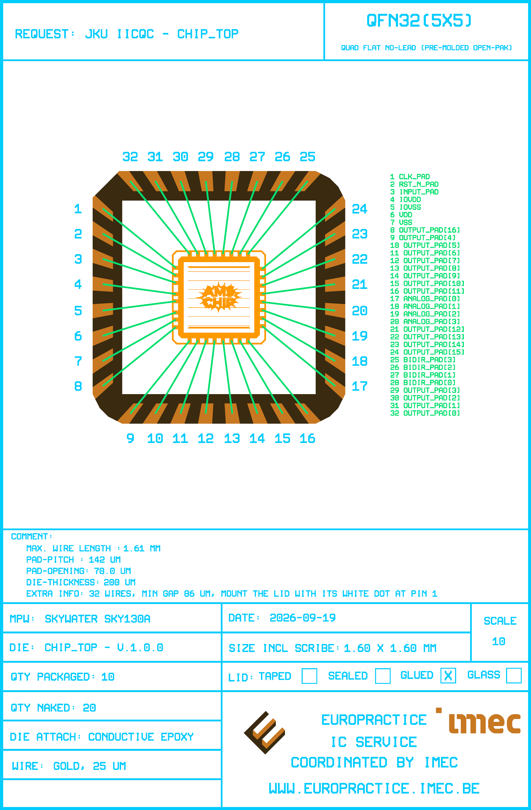

# Bondplan Report - chip_top v.1.0.0

Generated by `scripts/run_bondplan.py` on 2026-09-19.

## Summary

| | |
|---|---|
| Design | chip_top |
| Package | OP_QFN32_A4_FIT |
| Die size | 1.60 x 1.60 mm |
| Pad pitch / opening | 142 / 70.0 um |
| Bondwires | 32 (32 to leads, 0 exposed-pad downbonds) |
| Wire width | 25 um |
| Wire length | 1253 .. 1613 um |
| Min wire-to-wire gap | 86 um |
| Max lead skew | 2.2 deg |

## Bond Table

| Pin | Die pad | Die x/y (um) | Package x/y (um) | Length (um) | Angle (deg) | Skew (deg) | Min gap (um) |
|---|---|---|---|---|---|---|---|
| 1 | clk_PAD | 3969.2 / 9713.2 | 2725.0 / 10722.9 | 1602.3 | 140.9 | 1.7 | 86.2 |
| 2 | rst_n_PAD | 3969.2 / 9585.2 | 2725.0 / 10294.5 | 1432.1 | 150.3 | 1.0 | 86.2 |
| 3 | input_PAD | 3969.2 / 9457.2 | 2725.0 / 9864.7 | 1309.2 | 161.9 | 0.2 | 96.6 |
| 4 | IOVDD | 3969.6 / 9266.2 | 2725.0 / 9435.0 | 1256.0 | 172.3 | 1.2 | 98.0 |
| 5 | IOVSS | 3969.6 / 9143.2 | 2725.0 / 8984.5 | 1254.7 | -172.7 | 0.8 | 98.0 |
| 6 | VDD | 3969.6 / 8952.2 | 2725.0 / 8554.8 | 1306.5 | -162.3 | 0.6 | 92.2 |
| 7 | VSS | 3969.6 / 8829.2 | 2725.0 / 8125.1 | 1430.0 | -150.5 | 0.8 | 86.2 |
| 8 | output_PAD[16] | 3969.2 / 8701.2 | 2725.0 / 7699.1 | 1597.6 | -141.1 | 1.5 | 86.2 |
| 9 | output_PAD[4] | 4205.5 / 8474.0 | 3194.3 / 7229.7 | 1603.3 | -129.1 | 1.8 | 97.6 |
| 10 | output_PAD[5] | 4347.5 / 8474.0 | 3620.3 / 7229.7 | 1441.1 | -120.3 | 1.6 | 97.6 |
| 11 | output_PAD[6] | 4489.5 / 8474.0 | 4050.0 / 7229.7 | 1319.6 | -109.5 | 1.2 | 108.9 |
| 12 | output_PAD[7] | 4631.5 / 8474.0 | 4479.7 / 7229.7 | 1253.4 | -97.0 | 0.5 | 116.0 |
| 13 | output_PAD[8] | 4773.5 / 8474.0 | 4930.3 / 7229.7 | 1254.1 | -82.8 | 0.7 | 115.9 |
| 14 | output_PAD[9] | 4915.5 / 8474.0 | 5360.0 / 7229.7 | 1321.2 | -70.3 | 1.4 | 108.7 |
| 15 | output_PAD[10] | 5057.5 / 8474.0 | 5789.7 / 7229.7 | 1443.7 | -59.5 | 1.8 | 97.4 |
| 16 | output_PAD[11] | 5199.5 / 8474.0 | 6215.6 / 7229.7 | 1606.4 | -50.8 | 1.9 | 97.4 |
| 17 | analog_PAD[0] | 5440.4 / 8720.2 | 6685.0 / 7699.1 | 1609.9 | -39.4 | 2.0 | 93.1 |
| 18 | analog_PAD[1] | 5440.4 / 8857.2 | 6685.0 / 8125.1 | 1444.0 | -30.5 | 1.8 | 93.1 |
| 19 | analog_PAD[2] | 5440.4 / 8994.2 | 6685.0 / 8554.8 | 1319.9 | -19.4 | 1.1 | 104.2 |
| 20 | analog_PAD[3] | 5440.4 / 9131.2 | 6685.0 / 8984.5 | 1253.2 | -6.7 | 0.2 | 111.1 |
| 21 | output_PAD[12] | 5440.8 / 9268.2 | 6685.0 / 9435.0 | 1255.3 | 7.6 | 1.1 | 112.0 |
| 22 | output_PAD[13] | 5440.8 / 9410.2 | 6685.0 / 9864.7 | 1324.6 | 20.1 | 1.8 | 108.4 |
| 23 | output_PAD[14] | 5440.8 / 9552.2 | 6685.0 / 10294.5 | 1448.8 | 30.8 | 2.1 | 97.0 |
| 24 | output_PAD[15] | 5440.8 / 9694.2 | 6685.0 / 10720.4 | 1612.8 | 39.5 | 2.2 | 97.0 |
| 25 | bidir_PAD[3] | 5199.5 / 9945.5 | 6215.6 / 11189.7 | 1606.4 | 50.8 | 1.9 | 97.4 |
| 26 | bidir_PAD[2] | 5057.5 / 9945.5 | 5789.7 / 11189.7 | 1443.7 | 59.5 | 1.8 | 97.4 |
| 27 | bidir_PAD[1] | 4915.5 / 9945.5 | 5360.0 / 11189.7 | 1321.2 | 70.3 | 1.4 | 108.7 |
| 28 | bidir_PAD[0] | 4773.5 / 9945.5 | 4930.3 / 11189.7 | 1254.1 | 82.8 | 0.7 | 115.9 |
| 29 | output_PAD[3] | 4631.5 / 9945.5 | 4479.7 / 11189.7 | 1253.4 | 97.0 | 0.5 | 116.0 |
| 30 | output_PAD[2] | 4489.5 / 9945.5 | 4050.0 / 11189.7 | 1319.6 | 109.5 | 1.2 | 108.9 |
| 31 | output_PAD[1] | 4347.5 / 9945.5 | 3620.3 / 11189.7 | 1441.1 | 120.3 | 1.6 | 97.6 |
| 32 | output_PAD[0] | 4205.5 / 9945.5 | 3191.8 / 11189.7 | 1604.9 | 129.2 | 1.8 | 97.6 |
